# Johan Lin

**AI Application Engineer · Full-Stack Development**
M.Eng. in Computer Science @ Guangzhou University · 2024 – 2027

Building LLM-powered agent systems and full-stack applications — multi-agent orchestration, hybrid RAG, and LLM evaluation.

 &nbsp;&nbsp;&nbsp;  &nbsp;&nbsp;&nbsp; 

---

### 💼 Experience

**Test Development Intern · Baidu** `2026.11 – Present`

**AI Full-Stack Intern · MINISO (Guangzhou)** `2026.06 – 2026.09`

**AI Application Development Intern · Xin'an Data Co., Ltd. (Guangzhou)** `2026.03 – 2026.06`

**AI Application Development Intern · Suanwei Technology Co., Ltd. (Guangzhou)** `2025.07 – 2025.10`

---

### 🚀 Featured Projects

**Pet Wellness Advisor Agent** — AI-powered pet-health Q&A platform `2025.12 – 2026.02`

> Built solo, end to end: Supervisor-routed agents, hybrid retrieval over parent–child chunks, and knowledge-graph long-term memory.

- **Multi-agent orchestration** — LangGraph **Supervisor routing + Specialist executors** with parallel execution and ReAct-style tool calling; expert mode decomposes complex questions into a dependency-annotated **DAG**, layered by Kahn topological sort for same-layer parallel / cross-layer serial execution
- **Hybrid RAG** — vector + BM25 dual recall fused with **RRF**; parent–child chunk indexing (precise child matching, context-complete parent blocks); fine-grained reranking via `qwen3-rerank`
- **Knowledge-graph memory** — **Neo4j**-based long-term memory: ontology-constrained LLM triple extraction, two-layer entity dedup, vector + full-text + 1-hop-neighbor hybrid retrieval, **LPA** community clustering, and four-layer provenance (dialogue → chunk → statement → entity)

`Python` `LangGraph` `LangChain` `FastAPI` `Milvus` `Neo4j` `MySQL` `Celery` `Vue.js` `Docker`

---

### 🌱 Open Source Contributions

Contributing across the AI / agent ecosystem — connectors, MCP tooling, embeddings, and vision pipelines.

| Repo | Contribution | Status |
| :--- | :--- | :--- |
| [apache/seatunnel #11985](https://github.com/apache/seatunnel/pull/11985) | Pulsar connector declarative-validation migration, with 14 factory validation tests | ✅ Merged |
| [chroma-core/chroma #7637](https://github.com/chroma-core/chroma/pull/7637) | Migrate the Gemini example off deprecated SDK APIs | In review |
| [shcherbak-ai/contextgem #47](https://github.com/shcherbak-ai/contextgem/issues/47) → [#49](https://github.com/shcherbak-ai/contextgem/pull/49) | Gemma3 vision-capability misdetection, fixed in **v0.12.1** | ✅ Merged |

---

### 🧰 Tech Stack

`LangChain` `LangGraph` `Dify` `MCP` `Ollama` `LoRA Fine-tuning` `RAG (Hybrid Search + Rerank)` `LLM-as-Judge` `Milvus` `Neo4j` `Celery` `PaddleOCR` `Spring Cloud Gateway` `JWT / RBAC`

---

### 🐍 Contributions

<picture>
  <source media="(prefers-color-scheme: dark)" srcset="https://raw.githubusercontent.com/Linz1248/Linz1248/output/github-contribution-grid-snake-dark.svg" />
  
</picture>

---

🔥 Keep shipping —

